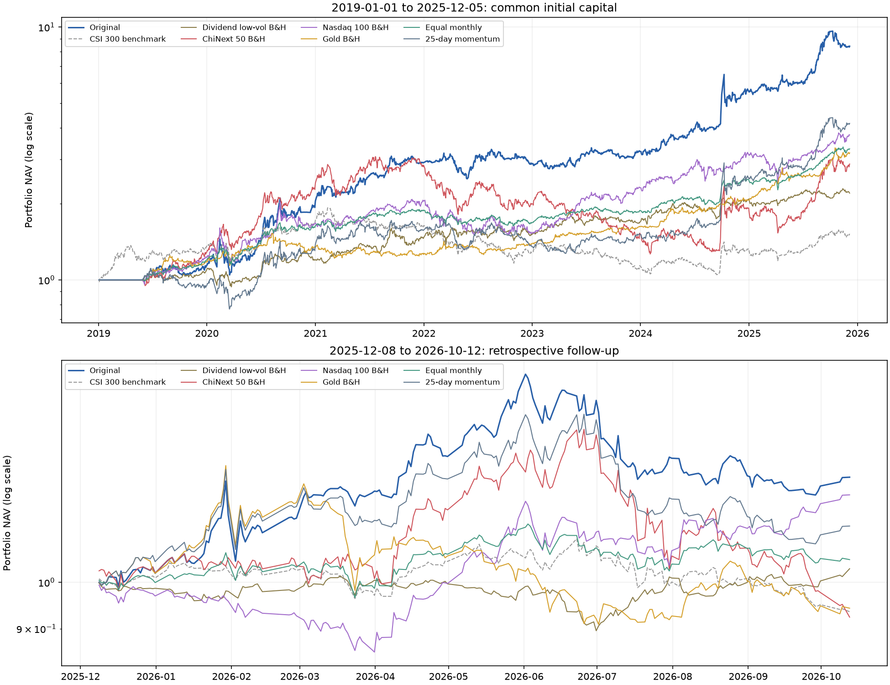

# QuantRadar ETF策略对照回测结果

2026-10-13完成。全部25组通过真实研究API运行，原策略未修改。原策略全区间复跑的8份CSV与此前任务逐字节一致。全部实际交易日覆盖与准备快照日历一致；完整运行ID及数据见manifest.json、results.json。

## 研究结论

1. 全区间原策略年化37.24%，高于四只分别持有、等权组合及简单动量。与创业板50单独持有相比，最大回撤从58.80%降至27.84%。这支持整体轮动规则的历史价值，但不能分解为每个因子分别有效；简单动量对照同时缺少原策略切换门槛。
2. 8组预定参数扰动年化33.59%—41.08%、回撤27.84%—28.57%，局部改动未导致失效；窗口变化也改变了预热和入场日期。未排除选池偏差、多重检验或更广范围的过拟合，不按最佳41.08%参数替换原策略。
3. 2倍/3倍成本年化33.89%/31.68%，比37.24%明显下降，但未失效。固定滑点压力不能代替实际盘口成交和资金容量测试。
4. 2022起点年化33.08%、回撤25.21%，收益并非完全依赖2019—2021的起点；后续区间累计26.94%、回撤23.98%，仍优于简单动量的13.62%收益和25.50%回撤。后续区间是回溯检查，不是前瞻样本外。
5. 原策略不是所有风险口径最优。全区间等权组合回撤14.28%、夏普1.136，原策略为27.84%和1.224；后续纳斯达克100持有回撤14.65%、夏普1.011，原策略为23.98%和0.936。高年化伴随更大的风险暴露。
6. 本次证据增强了对历史结果和局部稳健性的信心，没有证明未来可持续年化37%。原策略和参数保持不变；真正的下一步证据需事前冻结规则后的持续纸面跟踪，不根据本次最高收益重新挑参数。

## 全区间基础对照

| 测试 | 累计收益 | 年化收益 | 最大回撤 | 夏普 | 成交数 | 首笔交易 |
| --- | ---: | ---: | ---: | ---: | ---: | --- |
| 原策略 | 740.37% | 37.24% | 27.84% | 1.224 | 194 | 2019-05-29 |
| 红利低波买入持有 | 120.49% | 12.48% | 15.69% | 0.518 | 1 | 2019-05-29 |
| 创业板50买入持有 | 187.51% | 17.01% | 58.80% | 0.419 | 1 | 2019-05-29 |
| 纳斯达克100买入持有 | 274.69% | 21.71% | 28.43% | 0.755 | 1 | 2019-05-29 |
| 黄金买入持有 | 218.19% | 18.78% | 20.33% | 1.040 | 1 | 2019-05-29 |
| 四只等权月度再平衡 | 230.10% | 19.44% | 14.28% | 1.136 | 312 | 2019-05-29 |
| 简单25日动量 | 316.05% | 23.62% | 30.79% | 0.710 | 455 | 2019-05-29 |

## 预定参数扰动

| 测试 | 累计收益 | 年化收益 | 最大回撤 | 夏普 | 成交数 | 首笔交易 |
| --- | ---: | ---: | ---: | ---: | ---: | --- |
| 均线窗口48日 | 911.74% | 41.08% | 27.86% | 1.377 | 204 | 2019-05-13 |
| 均线窗口72日 | 824.50% | 39.20% | 27.84% | 1.295 | 190 | 2019-06-17 |
| 动量窗口20日 | 765.11% | 37.84% | 27.86% | 1.252 | 195 | 2019-05-22 |
| 动量窗口30日 | 808.81% | 38.85% | 28.57% | 1.275 | 174 | 2019-06-05 |
| 切换倍率1.2 | 911.06% | 41.07% | 27.86% | 1.366 | 228 | 2019-05-29 |
| 切换倍率1.8 | 776.14% | 38.10% | 28.54% | 1.249 | 176 | 2019-05-29 |
| 三因子权重各1/3 | 882.37% | 40.47% | 27.84% | 1.336 | 188 | 2019-05-29 |
| 权重0.2/0.2/0.6 | 600.94% | 33.59% | 28.57% | 1.096 | 206 | 2019-05-29 |

参数扰动保留各自预热逻辑；不同窗口可能改变首笔交易日。这是策略整体敏感性检查，不是严格控制建仓日期的单一因子消融。基准三因子权重0.3/0.3/0.4。

## 成本与起点

| 测试 | 累计收益 | 年化收益 | 最大回撤 | 夏普 | 成交数 | 首笔交易 |
| --- | ---: | ---: | ---: | ---: | ---: | --- |
| 原策略 | 740.37% | 37.24% | 27.84% | 1.224 | 194 | 2019-05-29 |
| 成本2倍 | 611.46% | 33.89% | 28.16% | 1.098 | 194 | 2019-05-29 |
| 成本3倍 | 536.40% | 31.68% | 28.27% | 1.015 | 194 | 2019-05-29 |
| 原策略2022年起点 | 196.61% | 33.08% | 25.21% | 1.037 | 115 | 2022-01-04 |

成本倍增同时提高双边佣金、最低佣金及固定价格滑点；FixedSlippage是价格单位，不能解释成统一百分比。2022起点组与全区间长度不同，应结合年度及后续区间判断，不能仅按年化排名。

## 后续区间回溯验证

| 测试 | 累计收益 | 年化收益 | 最大回撤 | 夏普 | 成交数 | 首笔交易 |
| --- | ---: | ---: | ---: | ---: | ---: | --- |
| 后续原策略 | 26.94% | —（不足一年） | 23.98% | 0.936 | 27 | 2025-12-08 |
| 红利低波买入持有 | 3.13% | —（不足一年） | 11.71% | -0.009 | 1 | 2025-12-08 |
| 创业板50买入持有 | -7.61% | —（不足一年） | 34.71% | -0.362 | 1 | 2025-12-08 |
| 纳斯达克100买入持有 | 21.95% | —（不足一年） | 14.65% | 1.011 | 1 | 2025-12-08 |
| 黄金买入持有 | -5.71% | —（不足一年） | 30.27% | -0.358 | 1 | 2025-12-08 |
| 四只等权月度再平衡 | 5.28% | —（不足一年） | 10.12% | 0.146 | 43 | 2025-12-08 |
| 简单25日动量 | 13.62% | —（不足一年） | 25.50% | 0.405 | 51 | 2025-12-08 |

后续区间不足一年，以累计收益为主要比较指标。各组均独立50万元起步。该数据已存在，本次不是前瞻样本外，不证明策略在设计时未看过2026行情。

## 原策略逐年表现

| 年份 | 收益 |
| --- | ---: |
| 2019 | 13.99% |
| 2020 | 80.40% |
| 2021 | 41.69% |
| 2022 | -0.97% |
| 2023 | 11.81% |
| 2024 | 71.70% |
| 2025 | 51.70% |

2025只截至12月5日。2019包含预热现金期。

## QuantRadar中的查看位置

策略列表搜索“验证ETF”，打开对应策略，再进入“回测列表/回测详情”。以下每个任务均有原生报告，但报告原生指标公式可能与应用统计不同；上述表格以收益概述公式为准。

| 测试 | 任务ID | 原生报告 |
| --- | --- | --- |
| original_full | 25f269697dd8400aafd87d6d248849da | [打开](http://127.0.0.1:7242/api/v2/runs/25f269697dd8400aafd87d6d248849da/report) |
| hold_512890 | 00ab3f6dc0b3436a85e9a165fc84d386 | [打开](http://127.0.0.1:7242/api/v2/runs/00ab3f6dc0b3436a85e9a165fc84d386/report) |
| hold_159949 | a39609640bbd4add9c3549744f0a1413 | [打开](http://127.0.0.1:7242/api/v2/runs/a39609640bbd4add9c3549744f0a1413/report) |
| hold_513100 | 282e5222ef7c447c84e32adc0be64c3b | [打开](http://127.0.0.1:7242/api/v2/runs/282e5222ef7c447c84e32adc0be64c3b/report) |
| hold_518880 | c2417175c29143cf8a66ad95ef54b68d | [打开](http://127.0.0.1:7242/api/v2/runs/c2417175c29143cf8a66ad95ef54b68d/report) |
| equal_monthly | 6fbb1b75ddb1444bbad36025a7786a14 | [打开](http://127.0.0.1:7242/api/v2/runs/6fbb1b75ddb1444bbad36025a7786a14/report) |
| momentum_25 | ee6bfb5ba87945a9850d9c6465063a6d | [打开](http://127.0.0.1:7242/api/v2/runs/ee6bfb5ba87945a9850d9c6465063a6d/report) |
| bias_48 | ec3940b9ac5543469635088ac614f346 | [打开](http://127.0.0.1:7242/api/v2/runs/ec3940b9ac5543469635088ac614f346/report) |
| bias_72 | f7c4da56d7364d6f9f270d84f7e7e6c7 | [打开](http://127.0.0.1:7242/api/v2/runs/f7c4da56d7364d6f9f270d84f7e7e6c7/report) |
| momentum_20 | 0e4508ebfed24dc0946342f0f69a9778 | [打开](http://127.0.0.1:7242/api/v2/runs/0e4508ebfed24dc0946342f0f69a9778/report) |
| momentum_30 | e5dd5cb6e8f243679bdbc0c591341559 | [打开](http://127.0.0.1:7242/api/v2/runs/e5dd5cb6e8f243679bdbc0c591341559/report) |
| switch_1.2 | 8c3fe03fd3054afc9475dd3729211885 | [打开](http://127.0.0.1:7242/api/v2/runs/8c3fe03fd3054afc9475dd3729211885/report) |
| switch_1.8 | 0301101d2fdd4bb3a6438cf254be2685 | [打开](http://127.0.0.1:7242/api/v2/runs/0301101d2fdd4bb3a6438cf254be2685/report) |
| weights_equal | 97189447518c4fb8a9cdd03d8c47e1e1 | [打开](http://127.0.0.1:7242/api/v2/runs/97189447518c4fb8a9cdd03d8c47e1e1/report) |
| weights_efficiency_60 | 54cb69af863542378fab19af4a3ea691 | [打开](http://127.0.0.1:7242/api/v2/runs/54cb69af863542378fab19af4a3ea691/report) |
| cost_2x | 2f1b4266c0fc41b185c83bdce6ed0f49 | [打开](http://127.0.0.1:7242/api/v2/runs/2f1b4266c0fc41b185c83bdce6ed0f49/report) |
| cost_3x | b662af339cff4bfaad074149dc6aa94b | [打开](http://127.0.0.1:7242/api/v2/runs/b662af339cff4bfaad074149dc6aa94b/report) |
| original_start_2022 | 9e757b2588214e6aa792c06e7d9801d7 | [打开](http://127.0.0.1:7242/api/v2/runs/9e757b2588214e6aa792c06e7d9801d7/report) |
| followup_original | e6a78f0a72894927a9cd8dd28177c257 | [打开](http://127.0.0.1:7242/api/v2/runs/e6a78f0a72894927a9cd8dd28177c257/report) |
| followup_hold_512890 | 13fde51badc14f17a64ecf12d780701a | [打开](http://127.0.0.1:7242/api/v2/runs/13fde51badc14f17a64ecf12d780701a/report) |
| followup_hold_159949 | bbcba04296794d85933ff7e2c95c5d2d | [打开](http://127.0.0.1:7242/api/v2/runs/bbcba04296794d85933ff7e2c95c5d2d/report) |
| followup_hold_513100 | b6dd5e19a1f1419988d6f55506422e11 | [打开](http://127.0.0.1:7242/api/v2/runs/b6dd5e19a1f1419988d6f55506422e11/report) |
| followup_hold_518880 | 0396e57eb2f34f1b88bd8c9699c95e63 | [打开](http://127.0.0.1:7242/api/v2/runs/0396e57eb2f34f1b88bd8c9699c95e63/report) |
| followup_equal_monthly | c8c57404f2a341cbaf6fc7ace451740a | [打开](http://127.0.0.1:7242/api/v2/runs/c8c57404f2a341cbaf6fc7ace451740a/report) |
| followup_momentum_25 | 5c8a86394dc84d958455508bca8d10e2 | [打开](http://127.0.0.1:7242/api/v2/runs/5c8a86394dc84d958455508bca8d10e2/report) |

应用统计：250交易日/年、年无风险利率4%、样本标准差；Alpha使用年化CAPM，超额收益使用策略/基准净值比。

实验规则与局限见[预先固定的设计](README.md)。所有结果均披露，不根据本次最佳结果替换原策略。
